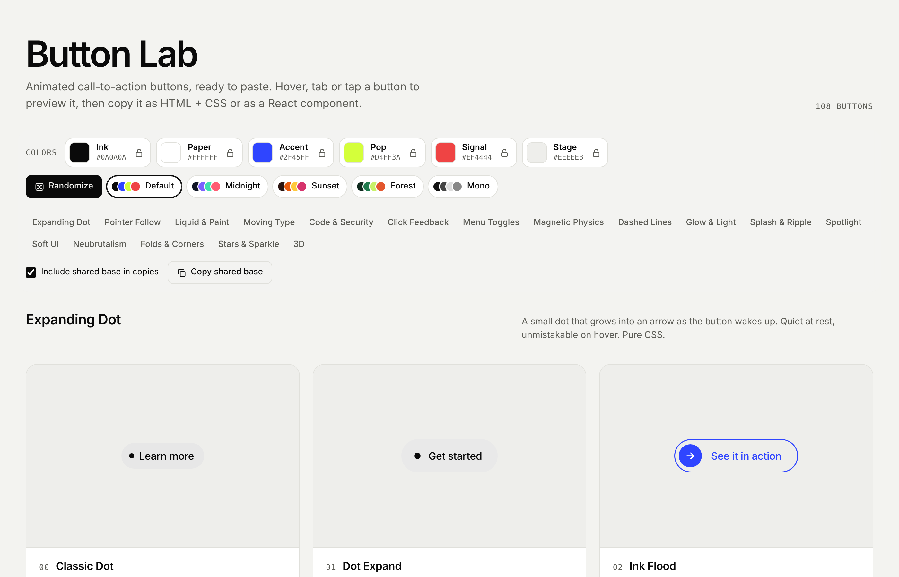
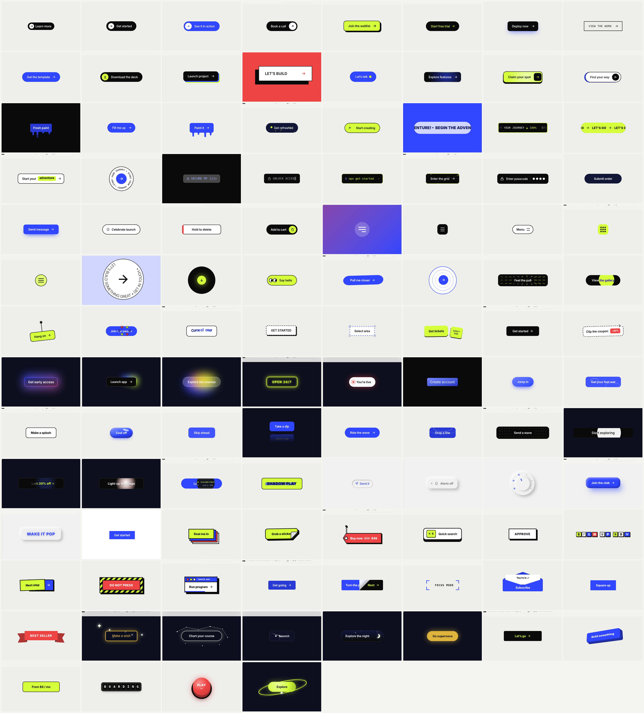

# The Lab

**108 animated call-to-action buttons. Preview them live, recolor all of them at once, and copy any one as HTML + CSS or a React component.**



The Lab is a single-page library of interactive buttons, from quiet hover states to spring physics, water ripples and click feedback. Every button reads from one shared five-color palette, so you can see the whole collection in your brand's colors before you copy a thing.

## Highlights

- **108 buttons in 17 sections**, each with a short description of what it does
- **Live palette:** five color variables (Ink, Paper, Accent, Pop, Signal) plus a preview background, all editable with color pickers
- **Randomizer with locks:** generate a matching palette in one click, and lock any color you want to keep
- **Presets:** Default, Midnight, Sunset, Forest and Mono
- **One-click copy** as self-contained HTML + CSS, or as a React component with its CSS included
- **Shared base option:** paste the shared variables and styles once, then copy slim per-button snippets
- **No dependencies:** plain HTML, CSS and a little vanilla JavaScript; nothing to install or build
- **Accessible by default:** real `<button>` elements, visible focus rings, keyboard support, correct ARIA states on toggles, and every animation switches off for people who prefer reduced motion
- **Works on phones:** tap any button to preview its effect

## The sections

| Section | Buttons | What it does |
| --- | --- | --- |
| Expanding Dot | 11 | A small dot grows into an arrow as the button wakes up |
| Pointer Follow | 5 | Buttons that lift toward, lean into or light up under the pointer |
| Liquid & Paint | 5 | Drips, sloshes, fizz and paint blobs |
| Moving Type | 5 | Marquees, tickers, slot-machine word reels and an orbiting badge |
| Code & Security | 5 | Scrambles, decryption, a typing terminal, glyph rain and a passcode unlock |
| Click Feedback | 5 | Loading into success, ripples, confetti, hold-to-confirm and add-to-cart |
| Menu Toggles | 5 | Menu icons that morph into an X, a back arrow or a dotted cross |
| Magnetic Physics | 10 | Spring-driven buttons that drift, stare, stretch, swing and swarm |
| Dashed Lines | 5 | Selection boxes, ticket stubs, wireframes and clip-out coupons |
| Glow & Light | 5 | Gradient halos, aurora glass, a neon tube and a broadcast pulse |
| Splash & Ripple | 10 | Splashes, rain, paint splats, a reflection pool and rolling ripples |
| Spotlight | 5 | A pointer-tracking light that reveals, mixes colored beams, x-rays and casts long shadows |
| Soft UI | 5 | Neumorphic buttons: soft shadows, a press-in toggle, a clicking dial, clay and embossed type |
| Neubrutalism | 10 | Hard shadows and loud color: a stacked deck, a peeling sticker, a swinging price tag, a keycap, a rubber stamp, a ransom note and more |
| Folds & Corners | 6 | Dog-eared corners, a page curl, a viewfinder, an envelope, filling corners and a folded ribbon |
| Stars & Sparkle | 5 | Bursting stars, a self-drawing constellation, shooting stars, a twinkling night sky and a supernova click |
| 3D | 6 | A rolling cube, an extruded block, a flipping card, a split-flap departure board, an arcade button and a ringed planet |



## Run it

Open `index.html` in any modern browser. That's it.

To serve it locally instead:

```bash
npx serve .
# or
python3 -m http.server
```

## Use a button in your project

1. Find a button you like and pick your colors in the color bar (or press **Randomize**).
2. Click **Copy HTML** or **Copy React**.
3. Paste it. The copy carries your chosen colors as five CSS variables at the top, so you can still fine-tune them by hand.

Using several buttons on one page? Click **Copy shared base** once, paste it into your page, then untick **Include shared base in copies** so each button copies on its own.

Every effect also runs when you add the class `is-active` to the button, so you can trigger a hover effect from your own code.

## Add a button

Each button is one entry in the `BUTTONS` list inside `index.html`:

```js
{
  group: 'click',            // which section it appears in
  no: '31',
  name: 'Submit Morph',
  cls: 'cta-submit',         // unique class name
  note: 'What the button does, in one sentence.',
  css: `/* styles for .cta-submit */`,
  html: `<button type="button" class="cta cta-submit">…</button>`,
  setup: setupSubmit,        // optional: JavaScript for interactive buttons
}
```

The page builds the card, the live preview, the code panel and both copy formats from that entry. Sections live in the `GROUPS` list just above it.

## Browser support

Current versions of Chrome, Edge, Safari and Firefox. The buttons rely on CSS custom properties, `color-mix()` and, for a couple of effects, `offset-path` and `mask`.

## Credits

Some sections began as riffs on open-source designs shared by the community on [Uiverse](https://uiverse.io), which publishes its elements under the MIT license. Thank you to everyone who shares their work there. Every button in The Lab has been rebuilt from scratch for the shared palette, both copy formats and accessibility.

## License

[MIT](LICENSE). Use these buttons in personal and commercial projects.
